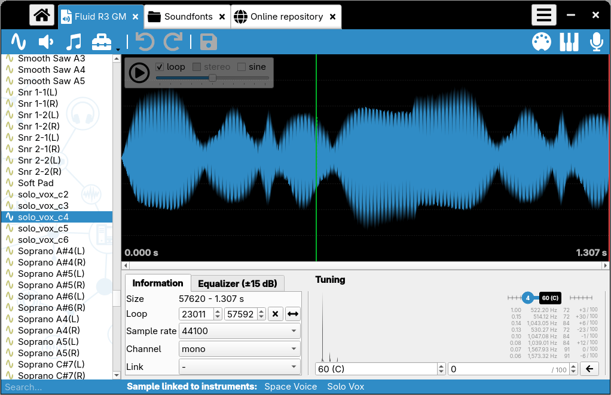
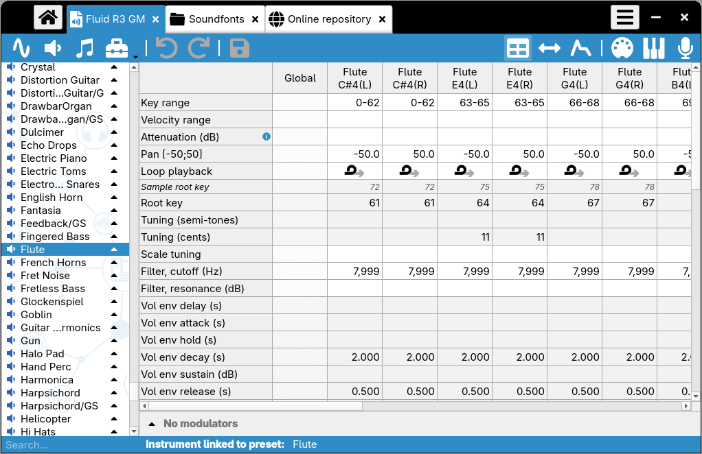
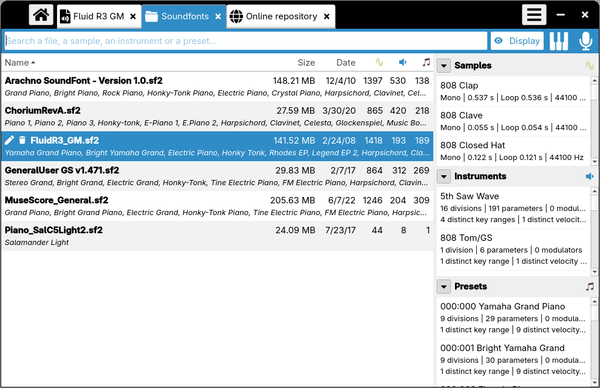
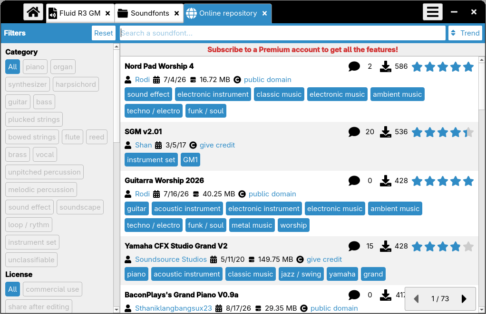
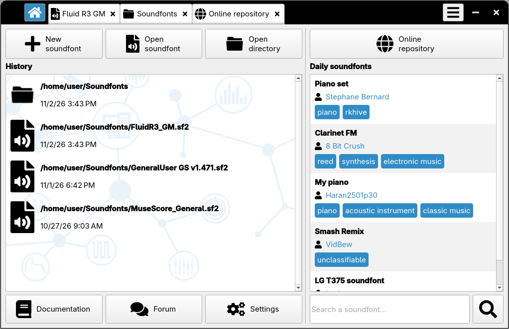
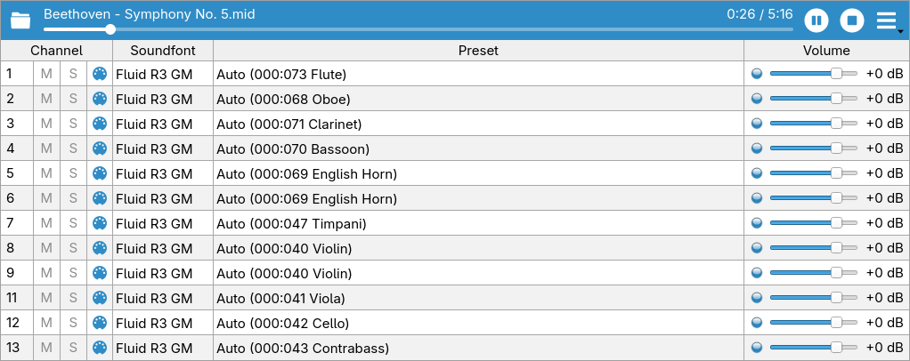
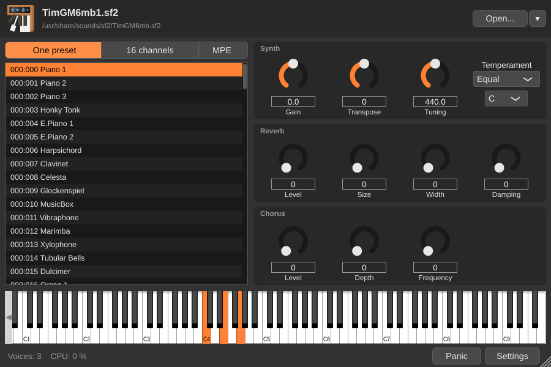

  

<h1 align="center">Polyphone</h1>

  <strong>Turn any sound into a musical instrument.</strong> 
  A free and open-source soundfont editor for Windows, macOS and Linux, 
  with a plugin to play your soundfonts in any DAW.

  
  
  

  <a href="https://www.polyphone.io">Website</a> ·
  <a href="https://www.polyphone.io/software">Download</a> ·
  <a href="https://www.polyphone.io/software/plugin">Plugin</a> ·
  <a href="https://www.polyphone.io/documentation">Documentation</a> ·
  <a href="https://www.polyphone.io/forum">Forum</a> ·
  <a href="https://www.polyphone.io/soundfonts">Soundfonts</a>

  

A soundfont is a single file holding everything a synthesizer needs to play an instrument: the recorded samples, how they are spread across the keyboard and the velocities, and how they are shaped by envelopes, filters and modulators.
Polyphone lets you create soundfonts from your own recordings, refine existing ones, convert them to other formats and play them right away with its built-in synthesizer.
The [Polyphone plugin](#polyphone-plugin) then plays them in your DAW with the same synthesizer, so they sound the same in your projects as in the editor.

## Features

### Formats

- **Soundfonts**: open and save sf2 (versions 2.01 and 2.04, 24-bit samples included) and sf3 (samples compressed with Ogg Vorbis).
- **Other instrument formats**: import and export sfz and DLS (DLS levels 1 and 2 are read, level 2 is written), import sfArk archives and GrandOrgue organs.
- **Samples**: import wav, flac, ogg, mp3, aiff and snd files, export samples as wav.
- **Analysis**: export every parameter of a soundfont in csv files, ready for a spreadsheet.

### Editing

- Tables showing all the parameters of samples, instruments and presets, where a value can be changed for several elements at once.
- Sample editor: waveform with loop points, stereo editing, frequency analysis estimating the pitch and the tuning, 10-band equalizer.
- Graphical editors for key and velocity ranges and for envelopes, with points that can be dragged with the mouse.
- Modulator editor, undo / redo, and a search field to find any sample, instrument or preset.

### Tools

More than 30 tools automate the repetitive work, for example:

- automatic loop of samples, cross-fade around the loop points, removal of the blank at the start;
- automatic positioning of the samples on the keyboard, transposition, detuning for celeste effects;
- creation of chords, organ mixtures and natural releases;
- volume, balance, attenuation, filtering and sound spatialization of many divisions at once;
- conversion of stereo samples to mono, merge of samples note by note, removal of unused elements, editing of samples in an external program.

### Playing

- Built-in synthesizer with reverb and chorus, played with the virtual keyboard, a MIDI keyboard or the computer keyboard.
- Player mode turning Polyphone into a synthesizer that can play several instruments or presets at once.
- MIDI file player: play a MIDI file with the open soundfonts, choose the soundfont and the preset of each channel, mute or solo channels, change the tempo and the pitch, and export the result to a wav file.
- Recorder saving what you play to a wav file.
- Audio output through the system, JACK or ASIO.

### Finding soundfonts

- **Soundfont explorer**: browse a directory of soundfonts, sort and filter them, see their samples, instruments and presets, and play them before opening them.
- **Online repository**: browse the soundfonts shared by the community on [polyphone.io](https://www.polyphone.io/soundfonts), filtered by category, license, tags or size and sorted by date, trend, downloads, rating, title or size.

### And also

- [Command line](https://www.polyphone.io/documentation/manual/annexes/command-line) for converting files to sf2, sf3, sfz, dls or csv, rendering a MIDI file into a wav file, or starting Polyphone as a synthesizer.
- Interface translated into 16 languages, with light and dark color themes or your own colors.

## Screenshots

<table>
  <tr>
    <td width="50%" valign="top">
      
      
Instrument editor

    </td>
    <td width="50%" valign="top">
      
      
Soundfont explorer

    </td>
  </tr>
  <tr>
    <td width="50%" valign="top">
      
      
Online repository

    </td>
    <td width="50%" valign="top">
      
      
Home screen

    </td>
  </tr>
  <tr>
    <td colspan="2">
      
      
MIDI file player

    </td>
  </tr>
</table>

## Polyphone plugin

  

The Polyphone plugin plays soundfonts in DAWs and in any other host of VST3, CLAP, LV2 or AU (macOS) plugins.
It uses the synthesizer of Polyphone, so a soundfont sounds the same in your projects as in the editor.
The plugin only plays soundfonts: they are created and edited with Polyphone, then opened in the plugin.

- Opens sf2, sf3, sfz and dls files with a button, from the recent files or by dropping them on the window.
- Three playing modes: one preset on the 16 MIDI channels; one preset per channel, chosen in the plugin or by program changes like a General MIDI synthesizer (handy for MIDI files); or one preset played by an MPE controller.
- Separate outputs for each MIDI channel and for the effects, to mix them on different tracks.
- Gain, reverb, chorus, transposition, tuning and temperament, all automatable by the host.
- The soundfont can be stored in the project, which then opens on another computer without the file.
- A soundfont used by several tracks is loaded in memory only once, and nothing is read from the disk while playing.
- Notes start exactly at the position of their MIDI message whatever the buffer size, and offline rendering is never limited by the processor.

The plugin is currently in beta. Download it from its [page on the website](https://www.polyphone.io/software/plugin), and see its [manual](https://www.polyphone.io/documentation/manual/plugin) for the installation and the settings.

## Install

Download the latest version from the [website](https://www.polyphone.io/software) or from the [GitHub releases](https://github.com/davy7125/polyphone/releases/latest):

| System | Package |
|---|---|
| Windows 10 or later (64-bit) | installer (.exe) or portable version (.zip) |
| macOS 12 or later | disk image (.dmg) for Apple silicon or Intel |
| Linux (x86-64 or ARM64) | AppImage |

Polyphone is also packaged for several Linux distributions, FreeBSD, Homebrew and Nix: see [Repology](https://repology.org/project/polyphone/versions) for the available versions, which may be older than the latest release.

The [plugin](https://www.polyphone.io/software/plugin) is downloaded separately, from its page or from the [GitHub releases](https://github.com/davy7125/polyphone/releases): one archive per system (Windows 64-bit, macOS 12 or later for Apple silicon or Intel, Linux x86-64 or ARM64) containing the VST3, CLAP and LV2 versions, plus AU on macOS. Its page explains where to copy each of them so that your host finds it.

Free code signing of the Windows version is provided by [SignPath.io](https://signpath.io/), certificate by [SignPath Foundation](https://signpath.org/).

Polyphone only connects to [polyphone.io](https://www.polyphone.io), for the version check, the messages of the home screen, the online repository and the user account. No personal data is collected, tracked or shared.

## Getting started

- New to soundfonts? The tutorial [Create a soundfont from scratch](https://www.polyphone.io/documentation/tutorials/create-a-soundfont-from-scratch) goes through all the steps.
- The [user manual](https://www.polyphone.io/documentation/manual/index) describes every window and tool, in 9 languages.
- The [plugin manual](https://www.polyphone.io/documentation/manual/plugin) explains how to install and use the plugin.
- Questions are welcome in the [forum](https://www.polyphone.io/forum).

## Building from source

Polyphone is written in C++ with Qt. Building instructions are available for [Windows](https://www.polyphone.io/en/documentation/development/building-polyphone-for-windows), [macOS](https://www.polyphone.io/en/documentation/development/building-polyphone-for-mac-os-x), [Fedora](https://www.polyphone.io/en/documentation/development/building-polyphone-for-fedora) and [Ubuntu](https://www.polyphone.io/en/documentation/development/building-polyphone-for-ubuntu), and for [building with Qt Creator](https://www.polyphone.io/en/documentation/development/using-qt-creator-to-build-polyphone).

The plugin is made with [JUCE](https://juce.com) and built with CMake on its own: see [sources/plugin/README.md](sources/plugin/README.md).

## Contributing

Bug reports, feature requests, pull requests and translations are welcome: see the [contributing guide](CONTRIBUTING.md).

## Supporting the project

Polyphone is free and its website shows no advertising. If you find it useful, a [donation](https://www.polyphone.io/donate) helps keep it online.

## License

Polyphone has been developed by Davy Triponney since 2013 and is released under the [GNU General Public License v3.0](LICENSE.txt).
The plugin uses JUCE under the AGPL v3 and [clap-juce-extensions](https://github.com/free-audio/clap-juce-extensions) under the MIT license.
